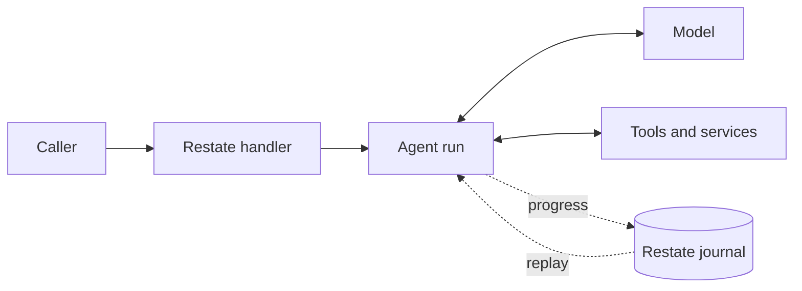

# Restate Agents

**TypeScript agents built for durable execution on [Restate](https://restate.dev).**
Run an agent inside a service handler, alongside ordinary application code.
Restate records its progress, so a crash, deploy, or long wait does not mean
starting the work over.

- **Survive the real world.** Model calls, tool results, and approvals are
  journaled; completed work is reused when an invocation resumes.
- **Stay in control while it runs.** Steer or interrupt an agent, check tool
  calls with guardrails, and pause for human approval.
- **Compose agents like services.** Call other handlers through durable RPC,
  delegate to sub-agents, or hand a conversation to a specialist.
- **Bring the tools you need.** Use async functions, Restate services, MCP,
  tool search, background work, and programmatic tool calling.

[Run the tutorial](#try-it) · [Explore the capabilities](#capabilities) ·
[Browse the numbered examples](packages/examples/README.md)

## The shape of an agent

An agent runs inside your Restate service. Your handler decides when to run it
and what happens before and after. The agent can call a model, use tools, wait
for a person, and continue from the journal when the invocation resumes.



Start with one agent and one handler:

```ts
import * as restate from "@restatedev/restate-sdk-gen";
import {agent} from "@restate-agents/core";
import {openAIModel} from "@restate-agents/core/openai";

const assistant = agent({model: openAIModel({model: "gpt-5.6-luna"})});

export const hello = restate.service({
  name: "Hello",
  handlers: {
    *ask(question: string) {
      const result = yield* assistant.run(question);
      return result.status === "completed" ? result.output : result.reason;
    },
  },
});
```

This is lesson 01 without its input schema. Each request starts with no
conversation history. Add a [conversation](packages/examples/src/lessons/03_conversation.ts)
when the agent needs to remember earlier requests, or add
[tools](packages/examples/src/lessons/02_tools.ts) when it needs to act.

## Try it

The [numbered tutorial](packages/examples/README.md) starts with this smallest
agent and builds toward approvals, multi-agent workflows, and a support session
with live controls. Start a Restate server, for example with
`pnpm dlx @restatedev/restate-server`, then run the example endpoint:

```sh
pnpm install --frozen-lockfile
export OPENAI_API_KEY=...
# Optional: export AGENT_MODEL=...  Lessons that need other keys say so.
pnpm dev
```

In another terminal:

```sh
pnpm dlx @restatedev/restate deployments register http://localhost:9080
curl localhost:8080/Hello/ask --json '"Say hello in one sentence."'
```

TypeScript callers can use Restate's typed client instead, as the
[example integration tests](packages/tests/src/examples.integration.ts) do:

```ts
import {connect} from "@restatedev/restate-sdk-clients";
import {hello} from "@restate-agents/examples/hello";

const answer = await connect({url: "http://localhost:8080"})
  .client(hello)
  .ask("Say hello in one sentence.");
console.log(answer);
```

`pnpm dev` compiles `packages/core` once at startup. After changing it, restart
`pnpm dev` and run the `register` command again so Restate sees changed services.

## What you can build

- **Support that remembers and adapts.** Keep conversation history in a keyed
  object, and steer or interrupt an active run.
  [See the support session](packages/examples/src/lessons/09_support_session.ts).
- **Actions with a human in the loop.** Pause a tool for approval or check a
  budget before it runs.
  [See human approval](packages/examples/src/lessons/06_human_approval.ts) and
  [a tool guardrail](packages/examples/src/lessons/13_tool_guardrail.ts).
- **Agents working together over RPC.** Fan out typed Restate RPCs and
  synthesize the results, or have agents review each other's drafts.
  [See the research report](packages/examples/src/lessons/08_research_report.ts)
  and [the peer review](packages/examples/src/lessons/15_peer_review_rpc.ts).
- **Coding in a Modal sandbox.** Give an agent file and shell tools backed by a
  [Modal](https://modal.com) sandbox (needs Modal credentials).
  [See the coding agent](packages/examples/src/lessons/11_coding_agent.ts).

## Why it keeps working

Restate journals model responses, tool results, and workflow decisions. After a
crash or redeploy, an invocation replays completed steps and continues from the
next one. Your agent does not have to reconstruct its place in a workflow or
repeat a completed model call.

- **Retries are explicit.** Set retry policies on model calls and tools; a terminal
  tool failure becomes a result the agent can handle.
- **Cancellation propagates.** An interrupted run cancels unfinished tools and
  child invocations.
- **Waiting does not occupy a process.** Approvals, sleeps, and slow work
  suspend durably.
- **Composition stays in application code.** Race agents, fan out workers, or
  add an agent to a larger Restate workflow.

## Capabilities

| Capability                   | API                                                                        | Lesson                                                      |
| ---------------------------- | -------------------------------------------------------------------------- | ----------------------------------------------------------- |
| Tools with journaled results | `asyncTool`, `tool`                                                        | [02](packages/examples/src/lessons/02_tools.ts)             |
| Conversation history         | `run(input, {messages})`, `LazyStateConversation`                          | [03](packages/examples/src/lessons/03_conversation.ts), 09  |
| Typed output                 | `agent({output})`                                                          | [04](packages/examples/src/lessons/04_structured_output.ts) |
| Human approval               | `needsApproval`, `onApproval`, `humanApprovalTool`                         | [06](packages/examples/src/lessons/06_human_approval.ts)    |
| Steering and interruption    | `run(input, {steeringSignal, interruptSignal})`                            | [09](packages/examples/src/lessons/09_support_session.ts)   |
| Progress events              | `run(input, {onProgress})`, `context.progress`                             | [16](packages/examples/src/lessons/16_progress_feed.ts)     |
| Handoffs                     | `handoff`                                                                  | —                                                           |
| Sub-agents as tools          | `agentTool`                                                                | —                                                           |
| Restate services as tools    | `serviceTool`, `handlerTool`, `restateTools` (`/discovery`)                | [10](packages/examples/src/lessons/10_service_tool.ts)      |
| Background tools             | `background: true`, `sleepTool`, `cancelOperationTool`                     | —                                                           |
| Tool search                  | `searchToolsTool`, `deferred: true`                                        | —                                                           |
| Programmatic tool calling    | `programTool` (`/program`), run in a QuickJS sandbox                       | —                                                           |
| MCP                          | `mcpTools` (`/mcp`)                                                        | [17](packages/examples/src/lessons/17_mcp_tools.ts)         |
| AG-UI clients                | `onProgress` and `onApproval` as AG-UI events and interrupts               | [18](packages/examples/src/lessons/18_ag_ui.ts)             |
| Guardrails                   | `beforeRun`, `beforeStep`, `beforeTool`, `afterTool`, `afterRun`, `before` | [13](packages/examples/src/lessons/13_tool_guardrail.ts)    |
| Web search                   | `webSearch` (`/web-search`)                                                | [14](packages/examples/src/lessons/14_web_search.ts)        |
| Models                       | `openAIModel` (`/openai`), `aiModel` and `modelGateway` (`/provider`)      | [shared.ts](packages/examples/src/shared.ts)                |

Subpaths are imports from `@restate-agents/core`, such as
`@restate-agents/core/mcp`. `aiModel` accepts an OpenTelemetry `tracer`.

Agents run inside Restate's generator SDK. A promise-based entry point existed
earlier and was removed; [PROMISE_SDK.md](PROMISE_SDK.md) explains how to bring
it back.

## Skills for coding agents

[`plugins/restate-agents`](plugins/restate-agents) teaches coding agents to
build with this SDK. It follows the same learning order as the lessons, with
two skills:

- **`restate-gen-sdk`** covers Restate's generator SDK: services, objects,
  workflows, durable RPC, fan-out, signals, and patterns for composing small
  handlers into larger applications.
- **`restate-agents`** covers the agent SDK: tools, conversations,
  approvals, guardrails, live controls, and multi-agent workflows.

The plugin also connects the Restate docs MCP server.

```sh
# Claude Code
/plugin marketplace add restatedev/agentsdk
/plugin install restate-agents@restate-agents
# Codex
codex plugin marketplace add restatedev/agentsdk
# Cursor, Copilot, Gemini CLI, and others
npx skills add restatedev/agentsdk
```

In Cursor, add `https://github.com/restatedev/agentsdk` as a marketplace
instead. To try local changes in Claude Code, run
`claude --plugin-dir plugins/restate-agents`.

## Workspace

| Package                                         | Purpose                                                              |
| ----------------------------------------------- | -------------------------------------------------------------------- |
| [`@restate-agents/core`](packages/core)         | The agent SDK, plus the optional subpaths listed above               |
| [`@restate-agents/examples`](packages/examples) | Numbered tutorials, from a first run to multi-agent workflows        |
| [`@restate-agents/tests`](packages/tests)       | Unit, replay, and type tests, plus integration tests against Restate |

The [domain glossary](CONTEXT.md) defines runs, steps, sessions, conversations,
and lifecycle controls.

## Development

Requires Node.js 22+ and pnpm 12. Integration tests also need Docker.

```sh
pnpm build             # compile, TypeScript 7 type check, type-aware Oxlint, Oxfmt check
pnpm test              # unit and journal-replay tests
pnpm test:integration  # a real Restate server with forced replay, via Testcontainers
```

`pnpm check` runs all three. `pnpm lint:fix` and `pnpm format:fix` apply fixes.
[CI](.github/workflows/ci.yml) runs the same checks on every pull request and
push to `main`. Provider and MCP fixtures need no paid credentials.
