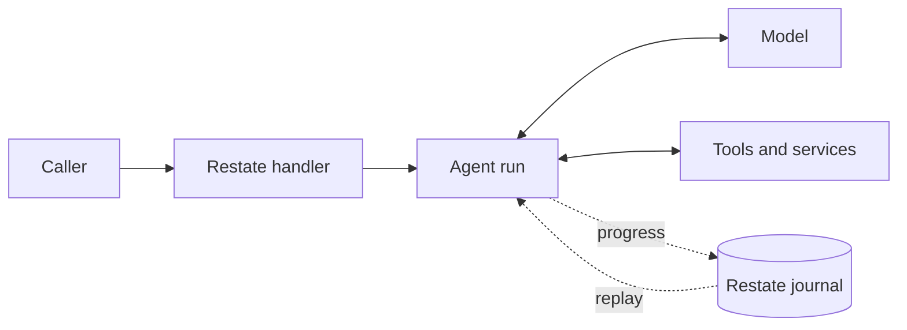

# Restate Agents

**TypeScript agents built for durable execution on [Restate](https://restate.dev).**
Run an agent inside a service handler, alongside ordinary application code.
Restate records its progress, so a crash, deploy, or long wait does not mean
starting the work over.

- **Survive the real world.** Model calls, tool results, and approvals are
  journaled; completed work is reused when an invocation resumes.
- **Stay in control while it runs.** Steer or interrupt an agent, enforce tool
  policies, and pause for human approval.
- **Compose agents like services.** Call other handlers through durable RPC,
  delegate to sub-agents, or hand a conversation to a specialist.
- **Bring the tools you need.** Use async functions, Restate services, MCP,
  tool search, background work, and programmatic tool calling.

[Run the tutorial](#try-it) · [Explore the capabilities](#capabilities) ·
[Browse the numbered examples](packages/examples/README.md)

## The shape of an agent

An agent runs inside your Restate service. Your handler decides when to run it
and what happens before and after. The agent can call a model, use tools, wait
for a person, and continue from the journal when the invocation resumes.



Start with one agent and one handler:

```ts
import * as restate from "@restatedev/restate-sdk-gen";
import {agent} from "@restate-agents/core";
import {openAIModel} from "@restate-agents/core/openai";

const assistant = agent({model: openAIModel({model: "gpt-5.6-luna"})});

export const hello = restate.service({
  name: "Hello",
  handlers: {
    *ask(question: string) {
      const result = yield* assistant.run(question);
      return result.status === "completed" ? result.output : result.reason;
    },
  },
});
```

Each request starts a fresh run. Add a [conversation](packages/examples/src/lessons/03_conversation.ts)
when the agent needs to remember earlier turns, or add
[tools](packages/examples/src/lessons/02_tools.ts) when it needs to act.

## Try it

The [numbered tutorial](packages/examples/README.md) starts with this smallest
agent and builds toward approvals, multi-agent workflows, and a support session
with live controls. Start a Restate server, then run the example endpoint:

```sh
pnpm install --frozen-lockfile
export OPENAI_API_KEY=...
pnpm dev
```

In another terminal:

```sh
pnpm dlx @restatedev/restate deployments register http://localhost:9080
curl localhost:8080/Hello/ask --json '"Say hello in one sentence."'
```

The same service also has a typed TypeScript client. From a program in this
workspace:

```ts
import {connect} from "@restatedev/restate-sdk-clients";
import {hello} from "@restate-agents/examples/hello";

const answer = await connect({url: "http://localhost:8080"})
  .client(hello)
  .ask("Say hello in one sentence.");
console.log(answer);
```

After updating the SDK, restart the endpoint and rediscover it so Restate sees
changed services.

## What you can build

- **Support that remembers and adapts.** Keep conversation history in a keyed
  object, and steer or interrupt an active turn.
  [See the support session](packages/examples/src/lessons/09_support_session.ts).
- **Actions with a human in the loop.** Pause a tool for approval or check a
  budget before it runs.
  [See human approval](packages/examples/src/lessons/06_human_approval.ts) and
  [tool policy](packages/examples/src/lessons/13_tool_guardrail.ts).
- **Research across workers.** Fan out typed Restate RPCs and synthesize their
  results. [See the research report](packages/examples/src/lessons/08_research_report.ts).
- **Coding in a sandbox.** Give an agent sandbox operations as tools inside a
  durable handler. [See the coding agent](packages/examples/src/lessons/11_coding_agent.ts).

The [tutorial](packages/examples/README.md) develops these patterns one lesson
at a time, from a single call through multi-agent workflows.

## Why it keeps working

Restate journals model responses, tool results, and workflow decisions. After a
crash or redeploy, an invocation replays completed steps and continues from the
next one. Your agent does not have to reconstruct its place in a workflow or
repeat a completed model call.

- **Retries are explicit.** Set policies on model calls and tools; a terminal
  tool failure becomes a result the agent can handle.
- **Cancellation propagates.** An interrupted run cancels unfinished tools and
  child invocations.
- **Waiting does not occupy a process.** Approvals, sleeps, and slow work
  suspend durably.
- **Composition stays in application code.** Race agents, fan out workers, or
  add an agent to a larger Restate workflow.

## Capabilities

- **Control:** Durable steering and interruption signals, human approval, and
  run and tool guardrails.
- **Compose:** Sub-agents as tools, conversation handoffs, and typed RPC to
  other Restate services.
- **Extend:** Async and service-backed tools, background calls, deferred tool
  search, MCP, web search, and sandboxed programmatic tool calling.
- **Integrate:** Restate-backed conversations, Zod-validated output, OpenAI and
  [AI SDK](https://ai-sdk.dev) model adapters, a model gateway, and OpenTelemetry
  tracing.

The current entry point targets Restate's generator SDK. See
[PROMISE_SDK.md](PROMISE_SDK.md) for the promise SDK design.

## Workspace

| Package                                         | Purpose                                                              |
| ----------------------------------------------- | -------------------------------------------------------------------- |
| [`@restate-agents/core`](packages/core)         | The agent SDK, plus optional model, MCP, PTC, and discovery adapters |
| [`@restate-agents/examples`](packages/examples) | Numbered tutorials, from a first run to multi-agent workflows        |
| [`@restate-agents/tests`](packages/tests)       | Unit, replay, and type tests, plus integration tests against Restate |

The [domain glossary](CONTEXT.md) defines runs, steps, sessions, conversations,
and lifecycle controls.

## Development

Requires Node.js 22+ and pnpm 11. Integration tests also need Docker.

```sh
pnpm build             # compile, TypeScript 7 type check, type-aware Oxlint, Oxfmt check
pnpm test              # unit and journal-replay tests
pnpm test:integration  # a real Restate server with forced replay, via Testcontainers
```

`pnpm check` runs all three. `pnpm lint:fix` and `pnpm format:fix` apply fixes.
[CI](.github/workflows/ci.yml) runs the same checks on every pull request and
push to `main`. Provider and MCP fixtures need no paid credentials.
