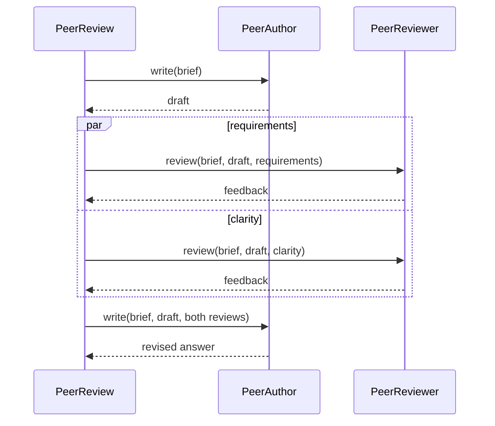

# Agent tutorial

Read the numbered files in [src/lessons](src/lessons) from `01` onward. Each file
stands alone; you do not need to import or edit previous lessons. Lessons 01–10
build up the agent and workflow primitives. The later lessons are goal-based
recipes you can read in any order. [services.ts](src/lessons/services.ts) lists
the services in tutorial order, [app.ts](src/app.ts) serves them, and
[shared.ts](src/shared.ts) configures the model.

Each prompt handler declares a Zod input schema with a scenario-specific
default for the request editor. The research example also supplies demo sources. Rediscover
the endpoint after changing a schema so Restate receives the updated defaults.
String bodies use `.meta({default: ...})` to prefill the editor while keeping
the request body required; object fields use `.default(...)`.

| Lesson | New concept                           | Source                                                             |
| ------ | ------------------------------------- | ------------------------------------------------------------------ |
| 01     | One agent, one request                | [01_hello.ts](src/lessons/01_hello.ts)                             |
| 02     | A tool with validated arguments       | [02_tools.ts](src/lessons/02_tools.ts)                             |
| 03     | Conversation history between requests | [03_conversation.ts](src/lessons/03_conversation.ts)               |
| 04     | Validated, typed output               | [04_structured_output.ts](src/lessons/04_structured_output.ts)     |
| 05     | A bounded draft-and-review loop       | [05_evaluator_optimizer.ts](src/lessons/05_evaluator_optimizer.ts) |
| 06     | Human approval                        | [06_human_approval.ts](src/lessons/06_human_approval.ts)           |
| 07     | Concurrent agents                     | [07_racing_agents.ts](src/lessons/07_racing_agents.ts)             |
| 08     | Parallel worker RPCs and synthesis    | [08_research_report.ts](src/lessons/08_research_report.ts)         |
| 09     | Conversation and turn controls        | [09_support_session.ts](src/lessons/09_support_session.ts)         |
| 10     | A whole Restate service as one tool   | [10_service_tool.ts](src/lessons/10_service_tool.ts)               |
| 11     | A coding agent in a Modal sandbox     | [11_coding_agent.ts](src/lessons/11_coding_agent.ts)               |
| 12     | Route to a specialist                 | [12_routing.ts](src/lessons/12_routing.ts)                         |
| 13     | Enforce a tool policy                 | [13_tool_guardrail.ts](src/lessons/13_tool_guardrail.ts)           |
| 14     | Search the public web                 | [14_web_search.ts](src/lessons/14_web_search.ts)                   |
| 15     | Exchange feedback over durable RPC    | [15_peer_review_rpc.ts](src/lessons/15_peer_review_rpc.ts)         |
| 16     | Follow an agent's progress            | [16_progress_feed.ts](src/lessons/16_progress_feed.ts)             |
| 17     | Tools from a remote MCP server        | [17_mcp_tools.ts](src/lessons/17_mcp_tools.ts)                     |

If you have a specific goal, start here:

| Goal                                 | Smallest lesson                         |
| ------------------------------------ | --------------------------------------- |
| Give an agent an API-backed tool     | [02](src/lessons/02_tools.ts)           |
| Remember earlier requests            | [03](src/lessons/03_conversation.ts)    |
| Require a person before a tool runs  | [06](src/lessons/06_human_approval.ts)  |
| Split research across workers        | [08](src/lessons/08_research_report.ts) |
| Steer or interrupt a running agent   | [09](src/lessons/09_support_session.ts) |
| Route a request by its meaning       | [12](src/lessons/12_routing.ts)         |
| Enforce a budget before an action    | [13](src/lessons/13_tool_guardrail.ts)  |
| Answer with current public sources   | [14](src/lessons/14_web_search.ts)      |
| Let agents review each other\'s work | [15](src/lessons/15_peer_review_rpc.ts) |
| Show progress while an agent works   | [16](src/lessons/16_progress_feed.ts)   |
| Use tools from an MCP server         | [17](src/lessons/17_mcp_tools.ts)       |

## Start

Start a Restate server (for example `pnpm dlx @restatedev/restate-server`), then
from the workspace root:

```sh
pnpm install --frozen-lockfile
export OPENAI_API_KEY=...
# Optional: export AGENT_MODEL=...
pnpm dev
```

In another terminal, register or rediscover the endpoint:

```sh
pnpm dlx @restatedev/restate deployments register http://localhost:9080
RESTATE_CALL_URL=http://localhost:8080
```

If your server uses a scoped call prefix, use that instead, for example:

```sh
RESTATE_CALL_URL='http://[fd07:b51a:cc66::2]:8080/restate/call'
```

## 01 — Run your first agent

Start with `agent({model})` and a single handler. The handler passes the request
to the agent and returns its answer as a JSON string. Each call starts with no
conversation history.

```sh
curl --globoff "$RESTATE_CALL_URL/Hello/ask" --json '"Say hello in one sentence."'
```

The response is just the answer, such as `"Hello!"`. The `replyText` helper
extracts the answer from the run result, or returns a short explanation if the
run stopped or was interrupted without producing an answer.

## 02 — Give the agent a tool

Add `instructions` and a `tools` map. `lookupTicket` declares its input with Zod
and returns a fixed demo record. The agent chooses when to call it and uses the
result in its answer.

```sh
curl --globoff "$RESTATE_CALL_URL/TicketLookup/ask" \
  --json '"What is the status of ticket T-42?"'
```

The lesson uses `asyncTool` with an ordinary `async execute(...)` callback.
The SDK journals its result, so you can replace the fixed record with an async
API call directly. The optional second argument supplies application context,
call metadata, and an `AbortSignal` for cancellable I/O.

The tool sets `retry` explicitly: up to five attempts, starting with a 250 ms
retry delay and doubling between attempts. See [retry policies](#retry-policies)
for model calls, individual actions, and handler calls.

Use `tool` when execution needs to compose SDK operations in a generator with
`yield*`. Use `handlerTool` for typed calls to other Restate handlers.

## 03 — Remember earlier requests

Change the service to a keyed Restate object. Before the run, load its saved
messages. Pass them to the agent, then save `result.messages` afterward. Return
only the reply; the history stays in object state.

```sh
curl --globoff "$RESTATE_CALL_URL/ChatSession/bob/ask" --json '"My name is Bob."'
curl --globoff "$RESTATE_CALL_URL/ChatSession/bob/ask" --json '"What is my name?"'
```

Both requests use `bob`, so the second sees the first exchange. A different key gets
its own history. This lesson stores the full history; the support-session lesson
adds conversation compaction and lifecycle controls.

## 04 — Return structured data

Add an `output` schema to describe the result. The SDK validates the model's
answer and gives the caller the typed object directly.

```sh
curl --globoff "$RESTATE_CALL_URL/TicketTriage/classify" \
  --json '"I was charged twice for my subscription."'
```

A successful response is an object such as
`{"category":"billing","summary":"The customer reports a duplicate subscription charge."}`
without a run-result wrapper. Lesson 05 uses this same mechanism to connect two agents.

## 05 — Compose a draft-and-review loop

One agent returns `{code}`; another returns `{approved, feedback}`. The handler
passes the draft and feedback into the next iteration, stopping at acceptance
or after three attempts. Each stage has a distinct run name.

```sh
curl --globoff "$RESTATE_CALL_URL/CodeReview/generate" \
  --json '{"task":"Read the first item of an array safely, returning undefined when it is empty."}'
```

The response is the accepted code as a string. If all three reviews reject the
draft, the response explains that it still needs work and includes the latest
feedback and code. Acceptance is the model's review decision; the code is
returned as text and never executed. The shared `completedOutput` helper makes
a stopped or interrupted run fail the stage instead of advancing the workflow.

A **run** completes one task; a **step** is one planning model call inside that
run. This loop starts fresh runs for successive drafts. See the
[glossary](../../CONTEXT.md) for the lifecycle terms.

## 06 — Wait for human approval

[The lesson](src/lessons/06_human_approval.ts) adds `needsApproval: true` to one
`closeTicket` tool. The tool simulates an async API call; no external ticketing
system is involved.

Start a request in one terminal:

```sh
curl --globoff "$RESTATE_CALL_URL/TicketApproval/bob/ask" \
  --json '"Close ticket T-42 after I approve it."'
```

This request waits. Before executing the tool, the SDK calls `onApproval(request)`
and then waits on a durable signal. The lesson saves the request directly in
object state. In a second terminal, inspect it:

```sh
curl --globoff --request POST "$RESTATE_CALL_URL/TicketApproval/bob/status"
```

`status` returns the stored request, containing the proposed tool name and arguments,
plus `invocationId` and `signalName`, or `null` when no request is stored. Copy
both identifiers from the request and submit a decision:

```sh
curl --globoff "$RESTATE_CALL_URL/TicketApproval/bob/approve" --json '{
  "invocationId": "<copy from status>",
  "signalName": "<copy from the same request>",
  "approved": true
}'
```

Approval resumes the waiting tool. The original
`ask` request returns only the agent's reply. To try rejection, start a request
under another key and submit `"approved": false`: the tool is skipped and the
agent receives a denied result. The `approve` handler directly resolves the
supplied invocation's signal and returns `true` to acknowledge sending it.
It does not check whether that request is still pending.

`status` and `approve` are shared handlers, so they run while the exclusive
`ask` handler is waiting. The example stores the latest approval request in one
state entry and clears it when the run ends, whether or not it succeeded. The SDK has no default
approval timeout; this lesson waits until a decision or invocation cancellation.

`onApproval` is also available on the agent definition. It receives a copy of the
request and the application's run context. The SDK awaits publication before waiting for a decision.
To publish to an event bus, use a journaled `run` operation or a durable service
call in the callback.

## 07 — Race concurrent agents

Spawn two agents and use `restate.any` to take the first successful answer. An
error or exhausted run cannot win. Interrupt and join the other task so its
cleanup finishes before returning; if both fail, return a terminal error.

```sh
curl --globoff "$RESTATE_CALL_URL/RacingAgents/answer" \
  --json '{"question":"How should a durable workflow handle external side effects?"}'
```

The response is the winning answer as a string. Both agents start, so the pattern can
consume more tokens than a single run. They share a model with different
instructions; change their `model` fields to compare providers.

## 08 — Delegate to parallel workers

The planner returns 2–4 questions. Start a `ResearchWorker` RPC for each, await
them concurrently, and synthesize the findings. Each worker gets its own source
context and reads supplied evidence through tools. A guard rejects citations to
sources it did not read. Parent cancellation also cancels unfinished worker calls.

```sh
curl --globoff "$RESTATE_CALL_URL/ResearchReport/generate" --json '{
  "topic": "Explain recovery and external side effects",
  "sources": [
    {
      "id": "journal",
      "title": "Durable execution",
      "text": "Restate journals completed operations and reuses their results during replay."
    },
    {
      "id": "effects",
      "title": "Idempotency",
      "text": "An external effect can repeat if its result was not committed. Use stable idempotency keys for external mutations."
    }
  ]
}'
```

The response is the final report as a string. Worker findings remain internal. This example uses
supplied documents and does not browse the web. Citation IDs are checked against
tool reads; factual quality and final prose still depend on the model.

## 09 — Run a controlled support session

A keyed object owns one conversation per key. `doTurn` runs one turn at a time
and stores the messages in object state, compacting long conversations. While a
turn runs, shared handlers inspect and control it: `status` shows the active
turn and any pending approval, `steer` adds a message, `interrupt` stops the
turn with a short summary, and `approve` answers an approval request. Ticket
effects are demonstrations.

```sh
curl --globoff "$RESTATE_CALL_URL/AiSession/bob/doTurn" \
  --json '{"message":"Look up ticket T-42, then close it after my approval."}'
```

`doTurn` returns only the answer or interruption summary. Read conversation
history through `history`. `steer` and `interrupt` have example messages.
For `approve`, copy `invocationId` and `signalName` from `status().approval` and set
`approved` to `true` to allow the action; its default is `false`.

## 10 — Expose a service as one tool

`serviceTool(refundIface)` turns a Restate interface into a single tool. The
model picks a handler (`getPolicy` or `issueRefund`) and passes its input; the
handler descriptions and input schemas come from the interface contract, so no
extra wiring is needed. Pass `{iface, handler: "issueRefund"}` to scope a tool
to one handler instead. Virtual objects and workflows also take a `key`.

```sh
curl --globoff "$RESTATE_CALL_URL/RefundAgent/ask" \
  --json '"Refund order O-99 for $12.50 and tell me the refund policy."'
```

Each call is a durable child invocation. Interrupting the run cancels an
unfinished call, and a failed handler is reported to the model as a tool error.

## 11 — Code in a Modal sandbox

`CodingAgent` gives an agent three tools, `readFile`, `writeFile`, and
`runCommand`, backed by a [Modal Sandbox](https://modal.com/docs/guide/sandbox).
The handler opens a sandbox, runs the agent, and releases the sandbox:

```ts
function* (task) {
  const sandbox = yield* connect();
  try {
    const result = yield* coder.run(task, {context: {sandbox}});
    return replyText(result);
  } finally {
    yield* release(sandbox);
  }
}
```

`connect` creates the sandbox in a journaled step, so a retried or replayed
request reuses it instead of creating another. Only the sandbox ID is
journaled; `connect` then wraps it in a Modal `Sandbox` handle, which needs no
I/O, and the tools use that handle from the run context. `release` terminates
the sandbox in a journaled step, so it runs once even if the request fails. Each tool is an
`asyncTool`, so its result is journaled like any other. `runCommand` makes one
attempt: a failure goes back to the model instead of running the command again.

Authenticate with `modal token new`, or set `MODAL_TOKEN_ID` and
`MODAL_TOKEN_SECRET`, then:

```sh
curl --globoff "$RESTATE_CALL_URL/CodingAgent/ask" \
  --json '"Write primes.js that prints the first 10 primes, then run it."'
```

## 12 — Route a request to a specialist

Use a small structured-output agent to choose `billing`, `account`, or `product`,
then let the chosen specialist answer. The application owns the branch:

```ts
function* (question) {
  const {specialist} = completedOutput(yield* route.run(question));
  const result = yield* specialists[specialist].run(question);
  return replyText(result);
}
```

```sh
curl --globoff "$RESTATE_CALL_URL/SupportRouter/answer" \
  --json '"I cannot log into my account. How can I regain access?"'
```

The specialist starts a fresh run with only the question. Use `handoff` when
the specialist should take over the **same** run and history.

## 13 — Enforce a policy before an action

`bookHotel.before` checks the authoritative quote and budget from application
context before `execute` runs. The model chooses a hotel ID, but cannot set its
price or bypass the limit by supplying a cheaper number. A denied tool call is
returned to the model so it can explain why no booking was made.

```ts
*before({hotelId}, {context}) {
  if (hotelId !== context.hotelId) return "Only the quoted hotel can be booked";
  if (context.quotedTotalCents > context.maxTotalCents)
    return "The quote exceeds the budget";
}
```

```sh
curl --globoff "$RESTATE_CALL_URL/GuardedBooking/ask" \
  --json '{"hotelId":"H-42","quotedTotalCents":12500,"maxTotalCents":10000}'
```

Raise `maxTotalCents` to `15000` to see the allowed path. The reservation is a
demo result; connect a real booking API only after obtaining the quote from your
own trusted service.

## 14 — Answer with current public sources

Set `TAVILY_API_KEY` before starting the example endpoint. `webSearch` sends a
public query to Tavily and journals the bounded results, so a replay does not
repeat the HTTP request. The agent is instructed to cite returned URLs and treat
snippets as evidence, not instructions.

```ts
const researcher = agent({
  model,
  maxSteps: 4,
  instructions: "Search the web before answering. Cite URLs returned by searchWeb, ...",
  tools: {searchWeb: webSearch({apiKey: apiKey ?? ""})},
});
```

```sh
curl --globoff "$RESTATE_CALL_URL/WebResearch/answer" \
  --json '"Find the current Restate TypeScript SDK docs and cite their URLs."'
```

Keep private data out of search queries. The key stays in application code and
is not part of the model's tool schema. If it is missing, the handler fails with
a clear setup error before calling the model.

## 15 — Let agents exchange feedback over RPC

`PeerReview` asks `PeerAuthor` for a draft, sends that draft to two
`PeerReviewer` invocations in parallel, and sends their labeled feedback back
to the author for one revision. Each role is a normal Restate service. The
conversation between them is explicit in typed request and response bodies:



```sh
curl --globoff "$RESTATE_CALL_URL/PeerReview/answer" \
  --json '"Write a two-sentence release note for a feature that retries transient failures and resumes completed steps from a journal."'
```

The caller receives only the revised answer. Restate journals each RPC, so a
replay does not repeat completed author or reviewer calls. There is no shared
mailbox or bespoke agent-to-agent protocol.

## 16 — Follow an agent's progress

The agent's `onProgress` handler sends each event to a `ProgressFeed` object.
Its shared `subscribe` handler waits for the next event.

```sh
curl --globoff "$RESTATE_CALL_URL/ProgressFeed/audit-1/subscribe" &
curl --globoff "$RESTATE_CALL_URL/InventoryAudit/audit" --json '{"job":"audit-1"}'
```

## 17 — Use tools from an MCP server

`mcpTools` lists a remote server's tools once, journals the catalog, and turns
each tool into a journaled step. The lesson uses the public
[DeepWiki](https://deepwiki.com) server; set `MCP_SERVER_URL` to use another.

```sh
curl "$RESTATE_CALL_URL/RepoGuide/ask" --json '"In restatedev/restate, what is a virtual object?"'
```

## Model configuration

[shared.ts](src/shared.ts) configures the example model. `openAIModel` defaults
GPT-5.6 function-tool requests to `reasoning_effort: "none"` to avoid the default
Luna model's Chat Completions tool/reasoning compatibility error. Explicit model
settings are preserved. Change an agent's `model` field to use another adapter
or gateway.

## Retry policies

Configure retries at the operation that can fail; there is no agent-wide retry
default. `maxSteps` limits the model/tool loop, not retries.

| Operation           | Where to configure it                                  | Example                                |
| ------------------- | ------------------------------------------------------ | -------------------------------------- |
| Ordinary async tool | `asyncTool({retry, ...})`                              | [02_tools.ts](src/lessons/02_tools.ts) |
| Model call          | `openAIModel({retry, ...})` or `aiModel({retry, ...})` | [shared.ts](src/shared.ts)             |
| Individual action   | `restate.run(action, {name, retry})`                   | Below                                  |
| Handler-backed tool | `retryPolicy` on the called service or handler         | —                                      |

Lesson 02 uses this policy; the same shape works for model adapters and
individual actions:

```ts
const retry = {
  maxAttempts: 5, // Includes the initial attempt.
  initialInterval: {milliseconds: 250},
  exponentiationFactor: 2,
  maxInterval: {seconds: 5},
  maxDuration: {seconds: 30},
};

// Compose this operation from a handler or tool.
function* performWithRetry() {
  return yield* restate.run(() => performAction(), {name: "Perform action", retry});
}
```

Without an explicit policy, `asyncTool` and the model adapters use three
attempts. A supplied policy replaces that default; specify `maxAttempts` when
you want a fixed attempt limit. The retry duration limits retries, not the
execution time of one attempt. Pass `callId` as an idempotency key for external
writes, since a retried attempt can repeat an effect.

For `asyncTool`, an ordinary thrown `Error` follows the retry policy.
`ToolError` is a business error returned to the model without retrying the
callback; `TerminalError` stops retrying. The policy covers `execute`; SDK
operations in `before` and `after` configure their own retries. Exhausting an
action's retry policy raises a `TerminalError`.

A tool that ends with a `TerminalError` (thrown directly, after exhausted
retries, or from a failed child handler) does not fail the agent. The model
receives `{status: "error", code: "tool_failed", message}` and decides what to
do next. Restate cancellation and agent limits still end the run.

`handlerTool` relies on the called handler's invocation policy: set
`retryPolicy` on the called service or handler, with `onMaxAttempts: "kill"`
to terminate after exhaustion or `"pause"` to leave the invocation paused for
manual intervention.

## Provenance and validation

The advanced workflow lessons adapt patterns from
[`restatedev/ai-examples`](https://github.com/restatedev/ai-examples), inspected at
commit `60d1eda2e5f3aae96db2efeba498e52367a01648`:

| Local example   | Upstream pattern                                                                                                                                                                                      | Changes in this implementation                                                                         |
| --------------- | ----------------------------------------------------------------------------------------------------------------------------------------------------------------------------------------------------- | ------------------------------------------------------------------------------------------------------ |
| Research report | [workflow-orchestrator.ts](https://github.com/restatedev/ai-examples/blob/60d1eda2e5f3aae96db2efeba498e52367a01648/typescript-restate-only/tour-of-agents/src/workflow-orchestrator.ts)               | Typed bounded plan, supplied evidence, source tools and guards, cancellation bridge                    |
| Code review     | [workflow-evaluator-optimizer.ts](https://github.com/restatedev/ai-examples/blob/60d1eda2e5f3aae96db2efeba498e52367a01648/typescript-restate-only/tour-of-agents/src/workflow-evaluator-optimizer.ts) | Structured decisions, previous draft carried forward, explicit exhaustion with the last draft retained |
| Racing agents   | [racing-agents.ts](https://github.com/restatedev/ai-examples/blob/60d1eda2e5f3aae96db2efeba498e52367a01648/typescript-restate-only/tour-of-agents/src/racing-agents.ts)                               | Embedded operations, first completed success, cancellation with joined cleanup                         |

The later goal-based lessons draw on the same patterns described by
[Anthropic's workflow guide](https://www.anthropic.com/engineering/building-effective-agents),
[OpenAI's tool guardrails](https://openai.github.io/openai-agents-python/guardrails/),
and the [AI SDK web-search recipe](https://ai-sdk.dev/cookbook/node/web-search-agent).
They use this library's Restate handlers and tools rather than copying another
framework's control flow.

Lesson 15 applies Restate's
[service-to-service calls](https://docs.restate.dev/ai/patterns/multi-agent) to a
bounded author-reviewer exchange. It combines durable RPC, parallel feedback,
and one explicit revision without extra messaging infrastructure.

`pnpm test:integration` registers these exported services with the official
`RestateTestEnvironment` and a real `RestateContainer().alwaysReplay()`. Tests
replace the model adapter import with fixture models using Node's module mocking.
They verify the introductory lessons, approval and denial before effects, rejection of stale decisions,
conversation isolation, parallel RPC execution, committed effects occurring once,
feedback propagation, bounded exhaustion, first-success racing, and loser cleanup.
The tests need Docker and make no paid model calls.

To modify a workflow, edit its agents and handlers directly. The
[example integration tests](../tests/src/examples.integration.ts) invoke those
same exported services through the Restate client and check returned results
and observable effects.
